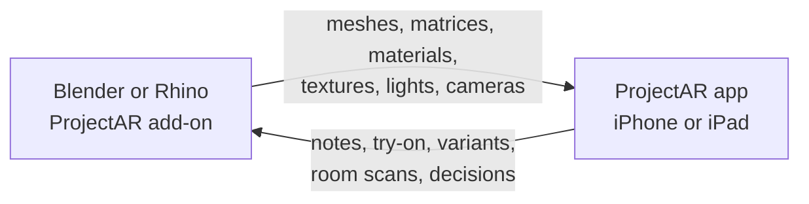

<div align="center">

# ProjectAR Add-ons

**See your Blender or Rhino model in augmented reality on iPhone and iPad, live, while you work.**

[](Blender%20Add-on/README.md)
[](Rhino%20Add-on/README.md)
[](#requirements)
[](Blender%20Add-on/ProjectAR-Blender-Addon.md#4-wire-protocol-version-1)
[](#development)
[](#license)

[Features](#features) · [Quick start](#quick-start) · [Blender guide](Blender%20Add-on/README.md) · [Rhino guide](Rhino%20Add-on/README.md) · [Specification](Blender%20Add-on/ProjectAR-Blender-Addon.md)

</div>

---

The add-on runs a small server inside your 3D app and streams the open scene over your local network to the **ProjectAR** iOS app. Move an object, add a modifier or change a material, and the AR view updates within a fraction of a second. Nothing leaves your network.

## Choose your add-on

| | Blender | Rhino |
|---|---|---|
| **Version** | 1.4.0 | 0.1.0, preview |
| **Runs in** | Blender 4.2 or newer, tested on 5.2 LTS | Rhino 8 on Windows or macOS |
| **Install** | Extension zip, *Install from Disk* | Unzip, then `RunPythonScript` |
| **Lives in** | ProjectAR tab in the 3D Viewport sidebar | Floating ProjectAR window |
| **Status** | Tested in Blender | Tested with stand-ins, not yet run in Rhino |
| **Guide** | [Blender Add-on](Blender%20Add-on/README.md) | [Rhino Add-on](Rhino%20Add-on/README.md) |

Both add-ons speak the same wire protocol, so the same app works with either one.

## Features

### Live streaming
- **Only changes are sent.** A move sends a new matrix, an edit resends that mesh, at most 10 times a second per object.
- **What you see is what you get.** Blender sends geometry with modifiers applied; Rhino sends the render meshes it shades with.
- **Instances, cheaply.** Collection, particle and Geometry Nodes instances, or Rhino blocks: each unique mesh is sent once, so 2,000 instances cost one mesh and a small entry each.
- **Real size in any units.** Everything goes to the app in meters, so millimeter and inch models land at real size and are lit correctly.
- **Several devices.** Devices find your computer over Bonjour, or you type the address. A device that joins late gets the whole scene.

### Materials, lights and cameras
- **Physically based materials** with base color, metallic, roughness, alpha and image textures. When only a material changes, only the material is sent.
- **Lights and cameras** go to the app, so it can light the model like your scene.
- **Camera from the phone.** Walk around the model and send the phone's view back as a scene camera.
- **USDZ snapshots** with full materials, saved to the app's Library.

### Design review in AR
- **Variants.** Turn a collection or layer into design options, and switch between them in the app or on the computer.
- **Notes** left on the model in AR appear in your scene, and notes you add appear in AR.
- **Material try-on.** Looks picked in the app can be applied to the model on the computer.
- **Room scans.** A LiDAR scan arrives as named boxes (Wall 1, Door 1, Table 1…) around your model.
- **Decisions** made in the room arrive with their photo, options and reason, and you can record your own at the computer.

### Research tools
- **Study sessions** for the screen condition use the same tasks, counterbalanced orders and timers as the app's Study Mode.
- **CSV exports** of activity logs and decisions use the same columns as the app, so the two conditions compare directly.

### Private by default
- **Asks before devices connect.** A new device gets nothing until you press **Allow**, and allowed devices are remembered.
- **Local only.** The server starts when you press **Start Server** and never contacts the internet.

## Quick start

1. **Install the add-on.** Ready-made zips are in each folder's `dist/`. Follow the steps for [Blender](Blender%20Add-on/README.md#installation) or [Rhino](Rhino%20Add-on/README.md#installation).
2. **Start the server.**
   - **Blender:** press **N**, open the **ProjectAR** tab and press **Start Server**.
   - **Rhino:** run ProjectAR and press **Start Server** in the **Connect** tab.
3. **Connect from the app.** Open ProjectAR on the iPhone or iPad, pick your computer under **Nearby**, then press **Allow** on the computer.
4. **Place the model.** Tap a surface, then keep working. The AR view follows your edits.

> [!TIP]
> If the app can't find your computer, put both on the same Wi-Fi. Guest, office and university networks often block traffic between devices, while a home router or a phone hotspot works. See [network and firewall setup](Blender%20Add-on/README.md#network-and-firewall-setup).

## Requirements

| Item | Requirement |
|---|---|
| **3D app** | Blender 4.2+ or Rhino 8 |
| **Device** | The ProjectAR app on an ARKit-capable iPhone or iPad. Variants, notes, try-on and room scans need app 1.2 or later. Instancing, lights, cameras and snapshots need app 1.4 or later. |
| **Network** | Computer and device on the same Wi-Fi or LAN, without client isolation |
| **Packages** | None. The Bonjour libraries are bundled as pure Python wheels. |

## How it works



The add-on watches the scene and sends only what changed. Data goes over TCP port 51515 as length-prefixed frames: JSON messages, binary meshes, textures and USDZ snapshot chunks. Everything is converted to meters and RealityKit's Y-up axes before it's sent. The add-on advertises itself over Bonjour (`_viewar._tcp`), which is how the app finds it under **Nearby**. Section 4 of the [specification](Blender%20Add-on/ProjectAR-Blender-Addon.md#4-wire-protocol-version-1) covers the protocol in full.

## Repository layout

```
.
├── README.md                          # this page
├── Blender Add-on/
│   ├── README.md                      # install and usage guide
│   ├── ProjectAR-Blender-Addon.md     # specification and wire protocol
│   ├── CHANGELOG.md
│   ├── build.py                       # packages viewar/ into dist/
│   ├── dist/                          # ready-to-install zip
│   ├── viewar/                        # add-on source
│   └── tests/                         # run inside Blender
└── Rhino Add-on/
    ├── README.md                      # install and usage guide
    ├── CHANGELOG.md
    ├── ProjectAR.py                   # run this in Rhino
    ├── build.py                       # packages projectar/ into dist/
    ├── dist/                          # ready-to-use zip
    ├── projectar/                     # add-on source
    └── tests/                         # plain Python, no Rhino needed
```

## Development

Build the Blender add-on zip:

```bash
python3 "Blender Add-on/build.py"
```

Run the Rhino tests and build its zip:

```bash
python3 "Rhino Add-on/build.py" --test
```

Run the Blender tests inside Blender (Blender must be on your `PATH`):

```bash
blender -b --factory-startup --python-exit-code 1 --python "Blender Add-on/tests/test_units.py"
```

Each folder has its own changelog: [Blender](Blender%20Add-on/CHANGELOG.md) and [Rhino](Rhino%20Add-on/CHANGELOG.md).

## Roadmap

- [ ] First full run of the Rhino add-on in Rhino 8 (see its [checklist](Rhino%20Add-on/README.md#first-run-in-rhino))
- [ ] Delta meshes: send only positions when the topology hasn't changed *(needs an app update)*
- [ ] Animated scatters: send instance transforms relative to their parent, so moving a scatter doesn't resend every instance *(needs an app update)*

## License

GPL-3.0-or-later, because the Blender add-on uses Blender's Python API; the Rhino add-on uses the same license. The ProjectAR iOS app is a separate program and isn't covered by this license.
